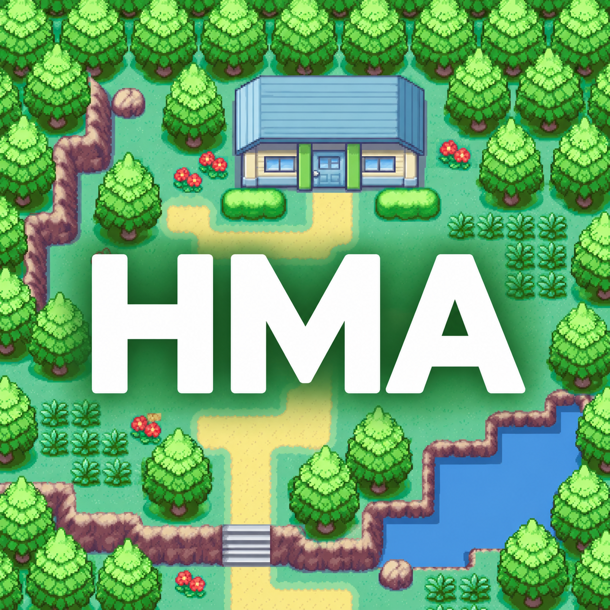

# HexManiacAdvance Mac Edition



A macOS edition of **HexManiacAdvance**, an editor for Pokémon Game Boy Advance ROMs,
with improvements to Mac controls, map editing, scripting and reliability.

Built on the remarkable work of **[Haven](https://github.com/haven1433/HexManiacAdvance)**,
who created HexManiacAdvance and its extensive tutorials, and
**[xavierkeys](https://github.com/Xkeys-bot/HexManiacAdvance-mac)**, who established the original
working Mac port. Thank you both for making this edition possible.

Mac Edition is maintained by [arkitekt13](https://github.com/arkitekt13).

**Mac Edition 1.0.1 is released for Apple Silicon**, signed with Developer ID and notarized by Apple.
The map, scripting and ROM utility features below are included in the release.

See the [feature and accomplishment summary](output/pdf/HexManiacAdvance_MacEdition_Accomplishments.pdf).
Maintainers can follow the [signing and notarization guide](docs/MAC_SIGNING.md) for future releases.

## Installation

### Option 1: Download the app

**[Download Mac Edition 1.0.1 for Apple Silicon](https://github.com/arkitekt13/HexManiacAdvance-MacEdition/releases/download/v1.0.1/HexManiacAdvance-MacEdition-1.0.1-osx-arm64.zip)** · [Release notes and checksum](https://github.com/arkitekt13/HexManiacAdvance-MacEdition/releases/tag/v1.0.1)

1. Download the **Apple Silicon / arm64** ZIP for an M-series Mac.
2. Open Downloads. If the ZIP has not unpacked automatically, double-click it.
3. Drag **HexManiacAdvance.app** into **Applications**.
4. Open the app from Applications, click **Open ROM**, and choose your `.gba` file.

**1.0.1 fixes a map/tile-selection crash in SCADE projects with missing learnsets**, including the reported SCADE + Ikarus Cerulean project. Save your work and quit HMA before replacing the app. Your project files stay separate. [Patch release notes](docs/RELEASE_NOTES_1.0.1.md).

The release is **Developer ID signed and Apple-notarized**. No .NET installation is needed.
Game ROMs and emulators are not included. Keep your project's `.gba` and matching `.toml` together.
Intel downloads are not offered in 1.0.1; Intel hardware remains unverified.
See the [Mac usage guide](docs/MAC_SETUP.md) for controls, utilities and troubleshooting.

### Option 2: Download and run the source code

1. Open **Apple menu → About This Mac**. If it lists an **Apple M-series chip**, choose **Arm64** in the next step. If it lists an **Intel processor**, choose **x64**.
2. Open the **[.NET 8 download page](https://dotnet.microsoft.com/en-us/download/dotnet/8.0)**. In **Build apps – SDK**, find the **macOS** row. Under **Installers**, download **Arm64** or **x64** for your Mac. Open the downloaded installer and finish installation.
3. **[Download the source ZIP](https://github.com/arkitekt13/HexManiacAdvance-MacEdition/archive/refs/heads/avalonia-port.zip)** and save it in **Downloads**.
4. Open Downloads. If the ZIP has not unpacked automatically, double-click it. Leave the extracted folder in Downloads, named **HexManiacAdvance-MacEdition-avalonia-port**.
5. Press **Command-Space**, type **Terminal**, and press **Return**.
6. Copy this entire command, paste it into Terminal, and press **Return**:

```sh
cd "$HOME/Downloads/HexManiacAdvance-MacEdition-avalonia-port" &&
dotnet run --project src/HexManiac.Avalonia/HexManiac.Avalonia.csproj
```

7. Wait for the app to open. The first launch downloads the files it needs and builds the app.
8. Click **Open ROM** and choose your `.gba` file.

Keep Terminal open while using this version. To launch it again later, repeat steps 5–6.
If a command fails, see [source launch troubleshooting](docs/MAC_SETUP.md#source-launch-troubleshooting).

## Included in Mac Edition 1.0.0

### ROM utilities

All three utilities are implemented and included under **Utilities** in the released app.

- **SCADE ROM base utility** - Start your own FireRed hack with a feature-rich ROM base built on expanded CFRU (Complete FireRed Upgrade) and DPE (Dynamic Pokémon Expansion), with additional features and fixes by [ShinyMiner & Team](https://github.com/Shiny-Miner/CFRU-expansion). HMA applies the patch to your exact unmodified English FireRed 1.0 ROM and installs the matching editor definitions (TOML) beside it automatically.
- **Ikarus Visual Upgrade** - Apply the reviewed visual and map upgrade to an English FireRed project after creating a verified named ROM/TOML backup, with Undo/Redo available.
- **Tutorial Village** - Create the supplied tutorial as a new ROM and matching TOML from exact unmodified English FireRed 1.1. Explore its map, NPCs and event scripts as editable examples; the original base stays unchanged.

Ikarus is recommended for unedited or minimally edited projects, without enforcing that recommendation. It appears compatible with vanilla FireRed, HUBOL, CFRU and SCADE, but further gameplay/build testing is required. It changes some map layouts and behaviors as well as graphics. Tutorial Village includes its finished IPS and matching metadata; users supply their own clean base ROM.

### Utility credits

| Included utility | Creators and original project |
| --- | --- |
| SCADE | **ShinyMiner & Team** — [CFRU Expansion](https://github.com/Shiny-Miner/CFRU-expansion) |
| Ikarus Visual Upgrade | **Ikarus & Many Contributors** — [Ikarus Tileset Patch V3.2](https://www.pokecommunity.com/threads/ikarus-tileset-patch-v3-2-fixed-version-gen-4-tiles-for-fire-red.532686/) |

The Ikarus fixed release includes bug fixes by **LibertyTwins**. Full contributor credits
and creator notes are preserved with the bundled utilities; HMA provides their installation workflow.

### Map editing

- **Trackpad panning and zoom** - Pan with Option-drag and zoom with the on-screen minus/plus buttons.
- **Clear map status** - See map dimensions and cursor coordinates, with pixel dimensions available on hover.
- **Map image export** - Save PNGs into a `MapImages` folder beside your ROM, choose which events to include, and overwrite or save an updated copy.
- **NPC sprite selection** - Choose a sprite before placing an NPC and remember that choice during the session.
- **Stable image previews** - Large sprites, tilesets, NPC summaries and Go To previews fit their available space without blocking clicks.
- **Steady border editing** - Paint border blocks without the panel repeatedly closing and reopening.
- **Reachable editor controls** - Scrollbars leave room for field arrows, tile flip controls stay clickable, and Block ID stays in place.
- **Reliable map edits** - Fixes cover interrupted drags, copied blocks, movement permissions, conditional map-script rows and Undo/Redo.

### Scripting

- **Map beside script source** - Switch to Map View to pan and zoom around a map reference, with an optional tile grid and no tile editing.
- **Click-to-open scripts** - Click objects, script events or script signposts in Map View to open their code, with Object ID and Flag or event Variable Number shown for context.
- **Steady, readable source** - Long scripts keep their place through compilation, selected text stays readable, and minus/plus buttons control text size.
- **Faster sign editing** - Enter through a signpost arrow to select just its first dialogue block for replacement.
- **Ready-to-fill script blocks** - Supported dialogue and movement commands insert `<auto>` and braces, including when chosen from suggestions.
- **Visible dialogue warnings** - Underlines show text that may overflow the in-game dialogue box.
- **Better flag and variable suggestions** - Suggestions account for more variable operands, refresh after edits and allow reuse after the final protected reference is removed.
- **Protected script drafts** - Navigation, saving, closing and Undo/Redo account for pending or rejected source.
- **Safe compilation failures** - Failed script/resource compilation restores ROM data while keeping your source and error messages.

### Everyday Mac use

- **Mac keyboard and mouse controls** - Command-C/X/V work in the active text field, and Control-click opens context menus.
- **Ready-to-type navigation** - Command-G opens Go To with the search field focused, including after changing ROM tabs.
- **Tutorial Village welcome image** - A faded map background introduces the project while keeping the welcome actions clear.
- **Easier field editing** - Short fields select their contents when reached with Tab, and encounter suggestions support mouse selection.
- **External emulator support** - Launch your saved ROM in an installed emulator such as mGBA.
- **Less repeated work** - Improvements reduce unnecessary rendering, script layout calculations, highlighting and data lookups.

See the [accomplishments PDF](output/pdf/HexManiacAdvance_MacEdition_Accomplishments.pdf) for a grouped summary and measured improvements, or the [detailed changelog](CodexChanges.md) for individual fixes and validation.

The released app's source baseline passed **89 groups / 25,320 assertions**, with **zero failures and zero skipped groups**, plus 23 separate supplied-tutorial/menu checks. The signed packaged runtime passed another **871 lifecycle assertions**. Apple's notarization service accepted the app, and the extracted download passes signature, ticket and Gatekeeper checks. See the [source and tutorial verification](tests/TutorialPatch/supplied-village-verification.json) and [notarized release verification](tests/MacPackaging/notarization-1.0.0-verification.json). These checks do not certify every gameplay path or every ROM expansion combination.

## Help

- **Learn ROM editing and scripting:** [Haven's HMA tutorials](https://github.com/haven1433/HexManiacAdvance/wiki).
- **Ask general HMA questions and share scripts:** [Join the official HMA Discord](https://discord.gg/x9eQuBg).
- **Connect mGBA or learn the Mac controls:** [Mac usage guide](docs/MAC_SETUP.md).
- **Report a Mac Edition bug:** [Open an issue](https://github.com/arkitekt13/HexManiacAdvance-MacEdition/issues).

Developers and testers: [build and verification commands](docs/DEVELOPMENT.md) · [testing checklist](docs/MAC_HELPER_TESTING.md).

## License

[MIT](LICENSE), retaining the original project's copyright and attribution.
